# Word Hunt

A solver for **Word Hunt** (the GamePigeon game in iMessage), and a bot that plays it for you on your iPhone through macOS iPhone Mirroring.

<p align="center">
  
</p>
<p align="center"><sub>Drawn from the bot's real output for one board: its solver chose the words and paths, and the swipe timing is its default speed. It's an animation, not a screen recording (made by <a href="docs/make_demo.py">docs/make_demo.py</a>).</sub></p>

- **Website:** type the 16 letters and see every word, with its path drawn on the board.
- **Autoplay:** press a hotkey during a game. The bot reads the board off the screen, solves it, and swipes the words in, highest score first, until the clock runs out.

## Website


It's a static page (`index.html` and `wordhunt.js`) that loads its dictionary with `fetch`, so serve the folder rather than opening the file directly:

```sh
python3 -m http.server 8000   # then open http://localhost:8000
```

## Autoplay

You need:

- macOS 15 (Sequoia) or later, with iPhone Mirroring set up
- Python 3.10+
- the regular 4×4 map (the donut, cross and 5×5 maps aren't supported)

### Setup

```sh
python3 -m venv .venv
.venv/bin/pip install -r autoplay/requirements.txt
```

The app you run it from (Terminal, iTerm, or Visual Studio Code if you use its terminal) needs three switches in **System Settings → Privacy & Security**:

| Permission | Used for |
|---|---|
| **Accessibility** | moving and clicking the mouse (the swipes) |
| **Input Monitoring** | hearing the hotkey and Esc while another app is in front |
| **Screen Recording** | screenshotting the iPhone Mirroring window |

If any are missing, the first run asks macOS to show the prompt and tells you which ones. macOS only applies a new permission to apps started afterwards, so quit and reopen the terminal app after turning one on. Running from Terminal rather than VS Code keeps these permissions away from your editor's extensions.

### Playing

1. Open iPhone Mirroring. Put the terminal beside it, not on top of it: the bot won't swipe through a window that covers the board.
2. Start the bot and leave it running. It prints `READY`.
   ```sh
   .venv/bin/python -m autoplay
   ```
3. In the mirroring window, open a Word Hunt game and tap **Start**.
4. Press **⌃⌥P** (Control-Option-P).

The bot reads the board in well under a second and shows it in the terminal. After a 1-second countdown it starts swiping, best words first. It stops by itself 1.5 s before the game's clock runs out (if it can't read the clock, it plays for `--time-limit` seconds), then goes back to `READY` for the next game. Ctrl+C in the terminal quits.

**To stop a game early,** touch the mouse or trackpad, or press Esc or the hotkey. Touching the mouse is the cleanest way, because keys also reach iPhone Mirroring, which passes typing on to the phone.

The bot also stops if the window moves or something covers the board. It only plays on something that looks like a live 4×4 board, so the "How to play" card, the results screen and game bubbles in the chat are ignored.

### Trying it without playing

- `.venv/bin/python -m autoplay read`: with a game open, it shows the board as read, the clock and the tile positions. It never touches the mouse.
- `.venv/bin/python -m autoplay --dry-run`: runs the full hotkey flow, but prints the swipe plan (words, tile numbers, screen coordinates) instead of swiping.
- `AUTOPLAY_GUI_TEST=1 .venv/bin/python -m pytest autoplay/tests/test_gui.py`: needs no phone; close iPhone Mirroring first.
  - It opens a fake phone window with a generated board and lets the bot play it for a few seconds with real mouse events.
  - It checks that every swipe hit the right tiles.
  - If real games don't register swipes but this passes, the Mac side works and it's a matter of speed (see below).

### Options and speed

| Option | Default | |
|---|---|---|
| `--hotkey` | `ctrl+alt+p` | modifiers plus a key, e.g. `cmd+shift+f5` |
| `--countdown` | `1` | seconds between reading the board and the first swipe |
| `--time-limit` | `70` | seconds to play when the game's clock can't be read |
| `--board LETTERS` | | use these 16 letters instead of reading them (tile positions still come from the screen) |
| `--now` | | play one game right away instead of waiting for the hotkey |
| `--dry-run` | | print the plan, never touch the mouse |
| `--steps` | `4` | drag events per tile-to-tile move |
| `--step-delay` | `0.01` | seconds between drag events |
| `--dwell` | `0.06` | seconds to rest on each tile centre |
| `--hold` | `0.05` | pause after pressing on the first tile and before letting go of the last |
| `--word-delay` | `0.15` | pause between words |

The last five set the speed. At the defaults a five-letter word takes about 0.75 s, so roughly 100 words fit in a round.

- **Letters in the middle of a word get skipped:** raise `--dwell` (try `0.1`, then `0.15`). iPhone Mirroring doesn't pass every mouse position to the phone, so a touch can jump straight past a tile; resting on each tile centre makes sure the phone sees it. Slowing every step with `--step-delay` helps much less.
- **The first or last letter gets dropped:** raise `--hold`.
- **Every word lands:** try faster, e.g. `--dwell 0.04 --word-delay 0.08`.

To keep settings, put them in `autoplay/settings.json`, using the option names with underscores:

```json
{"dwell": 0.1, "word_delay": 0.1}
```

Some words the bot swipes will still be rejected: its dictionary is the website's, and it has words GamePigeon doesn't accept.

### If the board isn't found

The bot finds the board on its own every game. If that fails on your screen, open a game and calibrate once:

```sh
.venv/bin/python -m autoplay calibrate
```

1. Hover over the centre of the top-left tile and press Enter.
2. Do the same for the bottom-right tile.

It saves all 16 tile centres to `autoplay/calibration.json`. Positions are relative to the window, so moving the window is fine; resizing it means calibrating again. It can then hover over each tile so you can check them. After that, the bot uses these positions whenever it can't find the board itself.

### How it works

1. **Find and capture.** It locates the iPhone Mirroring phone window (`CGWindowListCopyWindowInfo`) and screenshots just that window (`screencapture -l`).
2. **Read.** Vision's rectangle detection finds the tiles and its text recognition finds the letters, and a 4×4 grid is fitted to them. Each tile's letter is decided by a vote between the full screenshot and strips of tiles pasted side by side, because Vision reads lone round letters like O and C much better as part of a "word". The game's clock comes from the same screenshot.
3. **Solve.** `solver.py` is a port of `wordhunt.js`, using the same `utils/words.txt`, scoring and paths; it gave identical results to the website on 43 boards. Every path is checked before the mouse moves: in bounds, 8-way neighbours, no reused tile, and it spells the word.
4. **Swipe.** It sends Quartz mouse events: press on the first tile, drag in small steps to each tile centre and rest there, then release on the last. Diagonal moves cross only the gap where four tiles meet, so they don't brush the neighbouring tiles.
5. **Stay safe.** A listen-only event tap watches for the hotkey, Esc and your own mouse input. The bot's own events carry a tag, so it doesn't stop itself. Before every word it checks that the window hasn't moved and nothing covers the board.

### Tests

```sh
.venv/bin/python -m pytest autoplay
```

The tests cover:

- the solver, including the website's totals for a known board
- path validation
- grid fitting and tile-to-screen mapping
- swipe paths and timing
- the hotkey and safety checks
- OCR on generated boards

None of them need the phone.

## Project layout

```
index.html, wordhunt.js,      the website
lettertree.js, constants.js,
styles.css
utils/words.txt               the dictionary both use (197,762 words)
autoplay/                     the bot
  __main__.py                 command line: run, read, calibrate
  ocr.py, grid.py             finding and reading the board
  solver.py                   the website's solver in Python, plus path checks
  play.py                     swipe paths and timing
  mac.py                      the window, screenshots, mouse events, hotkey listener
  tests/                      pytest suite
docs/                         the demo animation and the script that draws it
```

## License

[MIT](LICENSE)
